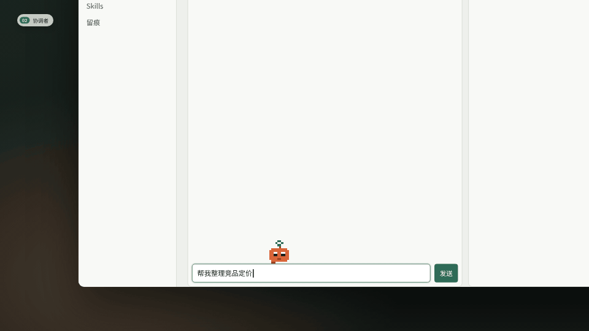
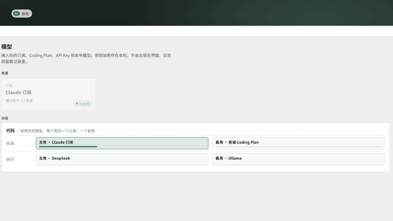
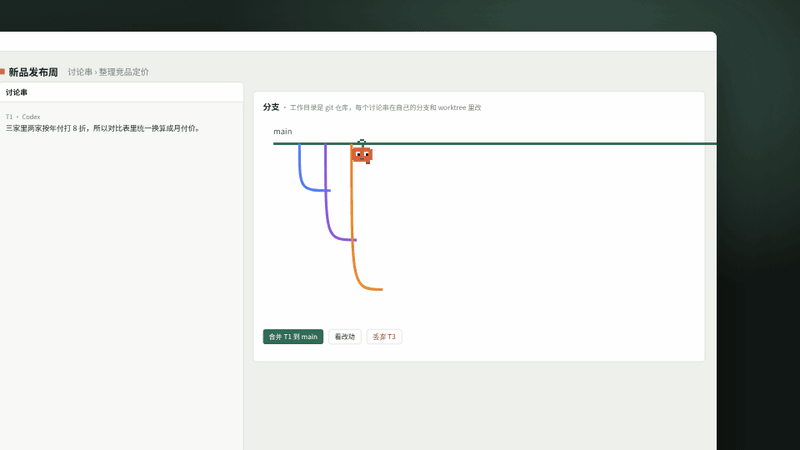
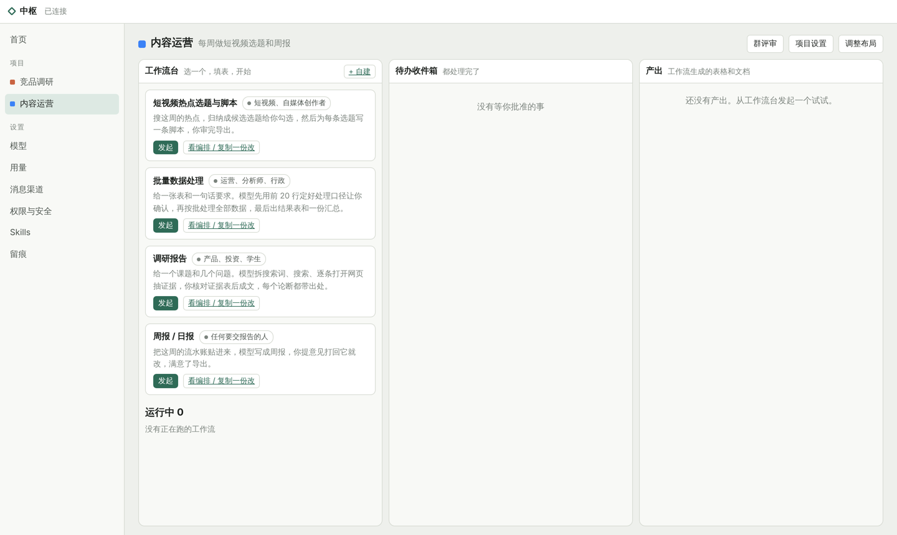
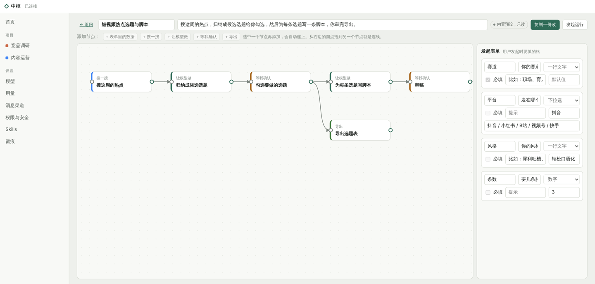
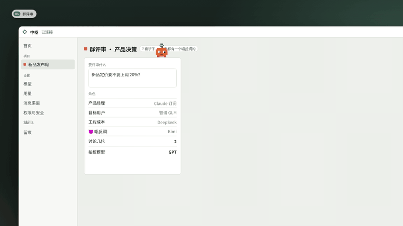
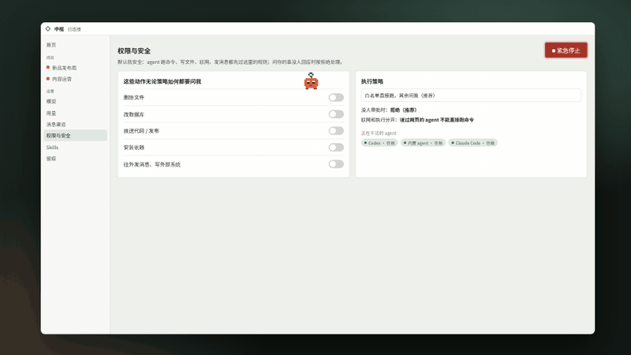

<div align="center">


# 中枢

**管好你的模型账号，再让一支 AI agent 团队替你干活**

你只跟协调者说一句话，它开讨论串、拆计划、派 agent 去做；<br>
跑命令、删文件、往外发消息这类事先问你；做完了自动归档。

[](https://github.com/xiaomo1231/Agent-scheduling/actions/workflows/check.yml)

[](LICENSE)


[快速开始](#快速开始) · [功能](#功能) · [架构](docs/architecture.md) · [路线图](docs/roadmap.md)



</div>

## 为什么用中枢

| 😵 以前 | ✅ 用中枢 |
|---|---|
| 五个模型账号、三个 agent、十几个窗口，额度一个接一个见底 | 所有账号接到一处，每种用途排好主用和备用，额度见底自动切换 |
| 每个 agent 都要你盯着、复制粘贴、来回传话 | 协调者拆计划、派活、跟进，全部做完自动解决 |
| agent 删文件、发消息、推代码，全凭它自觉 | 高风险动作一律先问你，人不在电脑前也能在手机上批准 |

## 功能

### 🔑 一处管好所有模型账号

订阅（Claude、ChatGPT）、Coding Plan（智谱、Kimi、OpenCode Go、火山方舟、百炼）、API Key（Anthropic、OpenAI、DeepSeek、OpenRouter）、本地模型（Ollama、LM Studio）都能接。按用途分组，每组排主用和备用；碰到额度上限时等它恢复或换备用，然后自动继续。每次调用都记 token，按模型、项目、天查看。密钥加密存在本机，不进界面、不进日志。



### 🧭 协调者带一支 agent 团队

跟协调者说要做什么，它开讨论串、排计划清单，把每一步派给内置 agent，或者交给 Claude Code / Codex / Gemini CLI 用你的订阅额度去做。运行中随时说“再加一步”“先做 T3”，计划跟着改，改动可以撤销。

- **双脑**：主脑排计划，副脑先挑毛病；主脑出错或额度用完，副脑接手。
- **独立分支**：项目是 git 仓库时，每个讨论串在自己的分支和 worktree 里干活，做完由你决定合并还是丢弃。
- **划词追问**：选中任意一段话开个侧枝单独问，聊完丢掉或把结论带回。
- **子 agent 和记忆**：内置 agent 可以派只读子 agent 并行查资料；项目记忆每次自动带上，每天整理一次。



### 🧩 不写代码也能用的工作流

给不写代码的人准备了四个现成模板：短视频热点选题与脚本、批量数据处理、调研报告、周报 / 日报。选一个、填表、点开始；需要你拍板的地方进“待办收件箱”，通过或附意见打回；结果在“产出”里下载。想改流程就复制一份，在画布上拖节点、连线、改参数。

<table>
<tr>
<td width="50%"></td>
<td width="50%"></td>
</tr>
<tr>
<td align="center">工作流台：选模板、填表、发起</td>
<td align="center">可视化编排：拖节点、连线、改参数</td>
</tr>
</table>

### ⚖️ 拿不准的事，开一场群评审

七套现成班子（方案评审、代码评审、产品决策、写作润色、风险评估、技术选型、头脑风暴），每套都有一个专门唱反调的。几轮讨论后由拍板模型给结论，贴回发起的地方。协调者遇到难题也会自己发起。



### 🛡️ 危险的事，先问你

默认就是安全的：命令按策略五档放行，白名单精确到参数；删文件、改数据库、推代码、装依赖、往外发消息一律要你批准；读过外部网页的 agent 跑命令要再确认；没人审批时默认拒绝。一键紧急停止。所有事件用哈希串成链，改过一条就对不上，启动时自动校验。



### 📱 人不在电脑前也能拍板

接上 Telegram 机器人后，待批准的事会推到手机上，点按钮就能批准或拒绝，也能直接跟协调者说话、查进度。飞书、钉钉、企业微信群机器人可以收通知。


<details>
<summary><b>全部功能清单</b></summary>

- **项目画布**：12 × 8 格子，像手机主屏幕一样拖动、改大小，挡路的模块自动让位；六种现成布局，包括“工作流模式”。
- **协调者的大脑**：API 模型（多轮调用工具）、订阅账号（通过官方 CLI 无界面模式）都可以；没配模型时用规则兜底。
- **讨论串**：带计划清单，可以加步骤、挪顺序、取消、撤销；全部做完、没有待批准、不用等你回答时自动解决；往已解决的讨论串发消息会重新打开。
- **模型**：常见服务都有预设，地址可改；思考强度按模型分挡（Claude 五挡对应官方 effort，GPT 系列对应 reasoning_effort）；Claude 官方 API 默认开启服务端兜底（被安全分类器拒绝时自动换模型重答）。
- **权限**：命令策略五档、精确到参数的白名单、“以后都允许”只放行同一条命令、内联代码必问、审批绑定指纹（命令改了就作废）、安全体检一键修复。
- **Skills**：导入 Claude Code / Codex / Gemini CLI / OpenCode / OpenClaw 的 skill，转成通用模板，静态扫描，高风险内容要你确认，带锁安装，再投放到各个 agent 的 skills 目录。
- **子 agent**：只读，最多 3 个同时跑；它带回的结论按外部内容处理。
- **项目记忆**：桌面页（每次都带上）+ 记忆条目（按相关度挑着带）；协调者和 agent 会自己记，每天自动整理一次。
- **搜索服务**：博查 / Tavily / Brave 任选一家，工作流的“搜一搜”和 agent 的 `web_search` 都走它。
- **留痕**：所有变化都是事件，前后用 SHA-256 串成链；改过一条就拒绝打开。密钥加密存在本机（桌面版用系统钥匙串），日志打码。
- **安装包**：AppImage / dmg / exe，打 `v*` 标签时自动出包。

</details>

## 快速开始

需要 Node 22 以上。

```bash
git clone https://github.com/xiaomo1231/Agent-scheduling.git
cd Agent-scheduling
npm install && npm run build
npm start                     # 打开桌面版（Electron）
```

还没接模型？先用模拟模式看看流程，用浏览器打开它打印出来的地址：

```bash
node packages/server/dist/cli.js --simulate
```

<details>
<summary><b>更多运行方式</b></summary>

不想装 Electron，只跑本地服务（数据放在 `~/.zhongshu`）：

```bash
node packages/server/dist/cli.js
```

开发时前后端分开跑：

```bash
npm run dev:server -- --port 4319 --dev-origin http://localhost:5173 --simulate
npm run dev:web        # 打开 http://localhost:5173/#token=…（token 用上一条命令打印的）
```

安装包：打 `v*` 标签后，GitHub Actions 会在三个系统上出包，在对应运行的产物里下载。

</details>

## 支持接入

| 类型 | 支持 |
|---|---|
| 订阅账号 | Claude、ChatGPT（通过官方 CLI 登录） |
| Coding Plan | 智谱、Kimi、OpenCode Go、火山方舟、阿里云百炼 |
| API | Anthropic、OpenAI、DeepSeek、OpenRouter，以及任何 OpenAI 兼容接口 |
| 本地模型 | Ollama、LM Studio |
| 执行 agent | 内置 agent、Claude Code、Codex、Gemini CLI |
| 消息渠道 | Telegram（双向）、飞书 / 钉钉 / 企业微信（通知） |
| 搜索 | 博查、Tavily、Brave |

## 参与开发

```
packages/core     纯逻辑：领域类型、事件与哈希链、权限判断、计划调整、工作流图等
packages/server   本地服务：模型接入、审批、运行器、协调者、工作流执行器、本地网关等
apps/web          React 界面，只通过网关和后端说话
apps/desktop      Electron 外壳
```

先读 [docs/architecture.md](docs/architecture.md)，里面写了依赖方向和必须遵守的安全约定；工作流的约定在 [docs/workflows.md](docs/workflows.md)。提交前跑 `npm run check`（类型检查 + 测试）。还没做的见 [路线图](docs/roadmap.md)。

> README 里的动图来自中枢的介绍片，界面按真实程序重画；工作流的两张图是真实截图。

## License

[MIT](LICENSE)
